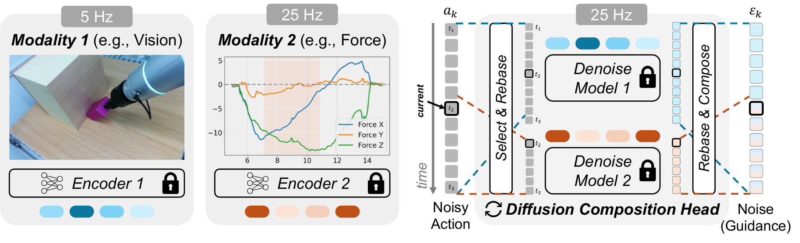

# MATE: Asynchronous Multi-Rate Diffusion Policy Composition

[[Paper]](https://arxiv.org/abs/2607.17257) [[Project Page]](https://lag-fusion.github.io/) [[Code]](https://github.com/Alan-Heoooh/MATE)

**Authors:** [Zihao He](https://alan-heoooh.github.io/)<sup>*</sup>, [Hongjie Fang](https://tonyfang.net/)<sup>*</sup>, [Shirun Tang](https://www.linkedin.com/in/shiruntang/), [Cewu Lu](https://www.mvig.org/)<sup>†</sup>, [Hao-Shu Fang](https://fang-haoshu.github.io/)<sup>†</sup>

<sup>*</sup> Equal contribution. <sup>†</sup> Corresponding authors.

<!-- Original method figure from https://lag-fusion.github.io/assets/method.png -->


Research code for [MATE](https://arxiv.org/abs/2607.17257). MATE composes independently trained diffusion policies at different inference rates, selecting overlapping action windows and rebasing diffusion variables between observation TCP frames.

The repository provides component training and two asynchronous composition pipelines:

- **Vision–force:** [RISE point clouds and an MLP force component](eval_mate_vision_force.py), with configured rates of 5 Hz and 25 Hz and linear horizon weights.
- **3D–2D vision:** [global point clouds and wrist RGB](eval_mate_3d_2d.py), with launcher defaults of 2 Hz and 5 Hz and equal composition weights.

## Setup

Clone the [MATE repository](https://github.com/Alan-Heoooh/MATE) and enter the repository root:

```bash
git clone https://github.com/Alan-Heoooh/MATE.git
cd MATE
```

Follow [INSTALL.md](assets/docs/INSTALL.md) for the Python/CUDA environment, bundled native extensions, and deployment SDKs. Data, checkpoints, measured calibration, and the site robot adapter are supplied separately.

Run commands from the repository root and create your machine configuration:

```bash
cp configs/local.example.yaml configs/local.yaml
```

Edit `configs/local.yaml` with dataset paths and recorded signal names. Fill live serials and measured ready poses before deployment. This file is ignored by Git; keep the public example generic.

Shell launchers resolve their paths from the repository root. CLI options override launcher environment variables and local/default paths. Component YAML expands `${MATE_NAME:-default}` using environment variables before local values. `MATE_LOCAL_CONFIG=/path/to/site.yaml` selects another local file; `MATE_LOCAL_CONFIG=''` disables local YAML loading while environment overrides remain active.

See [DATA.md](assets/docs/DATA.md) for recordings and preprocessing, and [CALIB.md](assets/docs/CALIB.md) for calibration files. Recorded camera IDs are independent of live camera serials.

## Train components

Training uses CUDA, NCCL, and `torchrun`. The launcher selects these templates:

| Component | Task | Default configuration |
| --- | --- | --- |
| `vision3d` | `flip`, `polish` | [vision_3d.yaml](configs/components/vision_3d.yaml) |
| `force` | `flip` | [force_flip.yaml](configs/components/force_flip.yaml) |
| `force` | `polish` | [force_polish.yaml](configs/components/force_polish.yaml) |
| `vision3d` | `pnp` | [pnp_vision_3d.yaml](configs/components/pnp_vision_3d.yaml) |
| `vision2d` | `pnp` | [pnp_vision_2d_h64.yaml](configs/components/pnp_vision_2d_h64.yaml) |

```bash
bash command_train.sh --component vision3d --task flip --data-path /path/to/flip
bash command_train.sh --component force --task flip --data-path /path/to/flip
bash command_train.sh --component vision3d --task pnp --data-path /path/to/pnp
bash command_train.sh --component vision2d --task pnp --data-path /path/to/pnp
```

Use `--task polish` for Polish and `--gpus 0,1` for two GPUs; one GPU is the default. `--config` and `--checkpoint-dir` override template/output selection. Environment calls such as `DATA_PATH=... COMPONENT=force TASK=flip bash command_train.sh` are also supported.

The [100-step RGB training configuration](configs/components/pnp_vision_2d.yaml) remains selectable with `--config`; the default RGB template predicts 64 steps for asynchronous deployment. With default roots, outputs go to `checkpoints/<task>/<component>/`. Keep each checkpoint's generated `hpara.yaml` for deployment compatibility checks.

Extra native-script flags are forwarded unchanged. `--resume_ckpt` loads model weights; `--resume_epoch` selects the last completed zero-based epoch. Checkpoints contain model state dictionaries, so optimizer and random-generator states are not restored.

## Compose and deploy

Use [DEPLOY.md](assets/docs/DEPLOY.md) for both launch commands, checkpoint/config precedence, device settings, weights, and action-horizon requirements. Starting evaluation enables the robot and moves it to the configured ready poses before the interactive start prompt.

## Citation and acknowledgements

```bibtex
@article{he2026mate,
  title={MATE: Asynchronous Multi-Rate Diffusion Policy Composition},
  author={He, Zihao and Fang, Hongjie and Tang, Shirun and Lu, Cewu and Fang, Haoshu},
  journal={arXiv preprint arXiv:2607.17257},
  year={2026}
}
```

The inherited main license is **CC BY-NC-SA 4.0**. See [LICENSE](LICENSE) and [THIRD_PARTY.md](assets/docs/THIRD_PARTY.md) for provenance, component licenses, and retained notices.
